# Projeto Cidades ESG Inteligentes

## EcoGestor API

**Giovanni Luiz do Rego — RM 563071**

Desafio DevOps da Fase 6. Evolução da API ESG em C# para gestão de resíduos e reciclagem.
O sistema registra unidades, pontos de coleta, coletas, destinações, alertas e indicadores.
Esta entrega usa a API original com SQL Server. Os scripts MongoDB da Fase 5 são um trabalho
separado; não foram convertidos nem executados sobre o banco relacional.

**Estado da entrega:** execução concluída e documentada em 13/10/2026. GitHub Actions
aprovou build, 12 testes automatizados e deploys em staging e produção simulada.
Os dois ambientes responderam às consultas de prontidão e unidades.
Consulte [validação](docs/VALIDACAO.md), [capturas reais](docs/EVIDENCIAS.md) e
[relatório final](docs/EcoGestor_DevOps_Final.pdf).

Repositório: https://github.com/GiovanniLuiz/EcoGestor-DevOps (privado; acesso depende de autorização).
Versão executada: `42fd1f59bb92aef482382bbffd3327c93bcff436`.

## Como executar localmente com Docker

Pré-requisitos: Windows 11 x64, Docker Desktop com backend WSL 2, Linux containers e
Docker Compose v2 com suporte a `up --wait`. Reservar memória suficiente para SQL Server
(pelo menos 2 GB por instância SQL, além de API, Docker e Windows; cerca de 8 GB para Docker
é uma referência para os dois ambientes de demonstração). Não é necessário Visual Studio.

Na pasta raiz do projeto, abra PowerShell:

```powershell
./scripts/New-LocalEnvironment.ps1
docker compose -p ecogestor-local up -d --build --wait --wait-timeout 300
```

O script cria `.env` com credenciais aleatórias. Leia `ADMIN_EMAIL` e `ADMIN_PASSWORD`
nesse arquivo para realizar login. Não envie `.env`, senhas ou tokens ao GitHub nem nos prints.
O arquivo `.env.example` descreve as variáveis necessárias e não contém credenciais reais.

Acesse:
- Interface de testes Swagger: http://localhost:8080/swagger
- Prontidão e banco: http://localhost:8080/health/ready
- Unidades: http://localhost:8080/api/unidades

No Swagger execute `POST /api/auth/login` com as credenciais do `.env`, copie apenas o token
para o botão Authorize e teste os endpoints protegidos. Não inclua o token nas evidências.
O Postman está em `postman/`; configure `baseUrl` e as credenciais no ambiente local.

```powershell
docker compose -p ecogestor-local ps
docker compose -p ecogestor-local logs --tail 100 api
docker compose -p ecogestor-local stop
docker compose -p ecogestor-local start
```

`stop` preserva os volumes e os dados. Não use `down -v` para reiniciar: essa opção apaga
os volumes. A inicialização aplica migrations e cria um administrador com senha armazenada
como hash, somente quando não há usuários. Alterar `ADMIN_PASSWORD` depois disso não troca
a senha cadastrada. Mantenha as credenciais durante as reexecuções.

### Execução dos testes sem Docker

Com o SDK .NET 8 instalado:

```powershell
dotnet restore EcoGestorApi.sln
dotnet build EcoGestorApi.sln -c Release --no-restore
dotnet test EcoGestorApi.sln -c Release --no-build --logger trx --results-directory TestResults
```

Os testes HTTP utilizam banco InMemory exclusivo por fixture. Eles não substituem a
verificação de SQL Server, realizada no pipeline com Docker Compose.
O teste de migration gera SQL sem conexão e confirma descoberta da migration e criação de tabelas.

## Pipeline CI/CD

Ferramenta: GitHub Actions. Arquivos: `.github/workflows/ci-cd.yml` e `deploy.yml`.

1. Pull requests para `main`: restauração, build, testes, imagem Docker e verificação da API com SQL Server real.
2. Push em `main` ou execução manual em `main`: as mesmas verificações, seguidas do armazenamento da imagem como artefato.
3. Runner Windows dedicado: baixa a imagem aprovada e faz deploy em staging.
4. Somente após staging passar: deploy da mesma imagem em produção.
5. Cada deploy confere saúde, ambiente, versão, consulta de unidades, login e relatório protegido.

A tag da imagem é o SHA do commit. Não se recompila uma imagem diferente na produção.
Uma falha bloqueia as etapas dependentes. Não há rollback automático; uma versão anterior
deve ser reimplantada conscientemente, considerando compatibilidade do esquema do banco.
Os dados são preservados nos volumes durante a atualização da aplicação.

Os ambientes são uma **simulação acadêmica persistente no computador**, não hospedagem pública.
Os runners hospedados no GitHub são usados para CI; o runner local mantém os deployments
depois que os jobs terminam. O computador deve estar ligado, conectado e com Docker e runner ativos.
Configuração detalhada: [Guia GitHub e ambientes](docs/CONFIGURACAO.md).

| Ambiente | Projeto Compose | URL | Banco e volume |
|---|---|---|---|
| Local | ecogestor-local | http://localhost:8080 | Volume próprio |
| Staging | ecogestor-staging | http://localhost:8081 | Volume próprio |
| Produção simulada | ecogestor-production | http://localhost:8082 | Volume próprio |

## Containerização

O Dockerfile usa uma etapa SDK para restaurar e publicar e uma etapa ASP.NET menor para executar.
A API roda como usuário `app`, sem privilégios de root. O `curl` serve ao healthcheck.
Conteúdo do Dockerfile:

```dockerfile
FROM mcr.microsoft.com/dotnet/sdk:8.0 AS build
WORKDIR /source
COPY src/EcoGestorApi/EcoGestorApi.csproj src/EcoGestorApi/
RUN dotnet restore src/EcoGestorApi/EcoGestorApi.csproj
COPY src/ src/
RUN dotnet publish src/EcoGestorApi/EcoGestorApi.csproj -c Release -o /app/publish --no-restore /p:UseAppHost=false

FROM mcr.microsoft.com/dotnet/aspnet:8.0 AS final
USER root
RUN apt-get update && apt-get install -y --no-install-recommends curl && rm -rf /var/lib/apt/lists/*
WORKDIR /app
COPY --from=build /app/publish .
ENV ASPNETCORE_HTTP_PORTS=8080
EXPOSE 8080
USER app
HEALTHCHECK --interval=10s --timeout=5s --start-period=60s --retries=12 CMD curl --fail --silent http://localhost:8080/health/ready || exit 1
ENTRYPOINT ["dotnet", "EcoGestorApi.dll"]
```

Compose sobe `api` e `db`, conectados pela rede `backend`. O banco não publica a porta 1433
no host. O volume `sql-data` mantém os dados; Compose prefixa redes e volumes com o nome
do projeto, isolando os ambientes. A API só inicia depois de o healthcheck do SQL passar.

O SQL Server Developer é usado exclusivamente nesta demonstração acadêmica, inclusive no
ambiente chamado Production; não representa licenciamento para uso comercial em produção.
As portas da API escutam apenas em `127.0.0.1`. Se houver hospedagem pública futura, será
necessário configurar HTTPS, proxy, credenciais e acesso ao banco adequados à hospedagem.

### Banco e migrations

A migration inicial foi reconstruída a partir dos modelos para bancos NOVOS desta fase,
pois o pacote anterior tinha snapshot incompleto e migration sem metadados de descoberta.
Não apontar esta versão para um banco antigo sem planejar a migração dos dados.
As migrations são aplicadas na inicialização, adequadas à instância única por ambiente
desta demonstração. Há dados iniciais de duas unidades e dois pontos de coleta.

## Prints do funcionamento

Capturas reais da execução de 13/10/2026. Índice completo: [Evidências](docs/EVIDENCIAS.md).

### E01 - Docker local: construção e inicialização

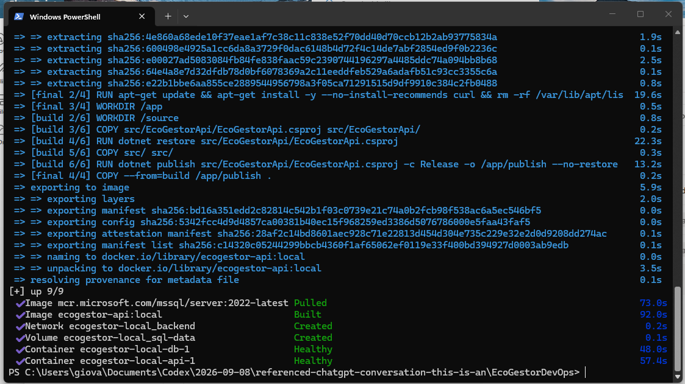

### E02 - Etapas de build e integração no GitHub

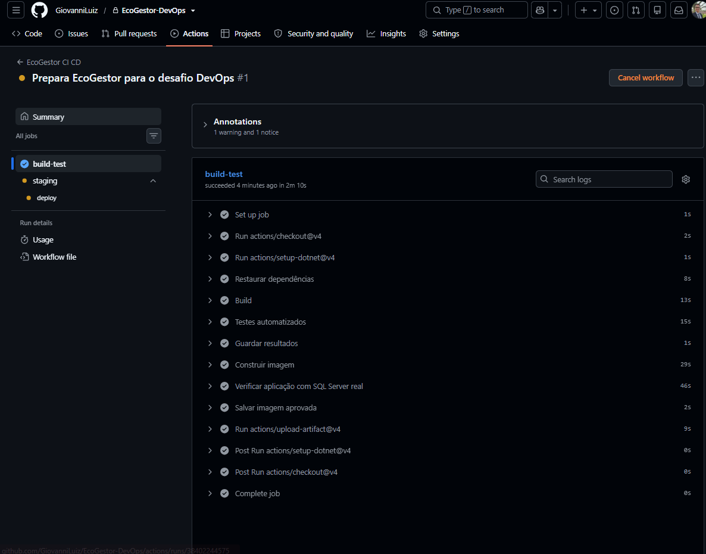

### E03 - Testes automatizados: 12 aprovados, zero falhas

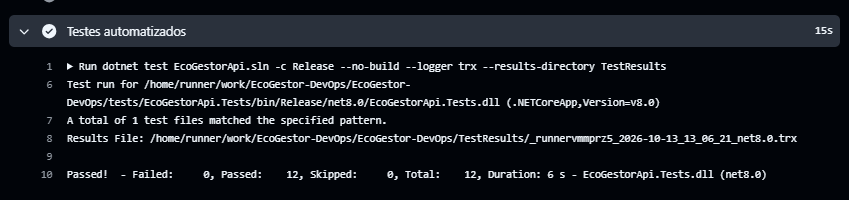

### E04 - Pipeline concluído: build, staging e produção

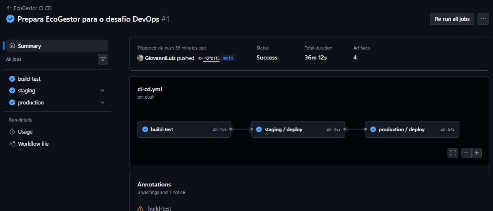

### E05 - Staging: prontidão na porta 8081

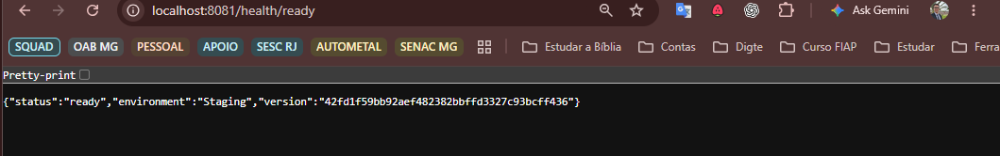

### E06 - Staging: consulta de duas unidades

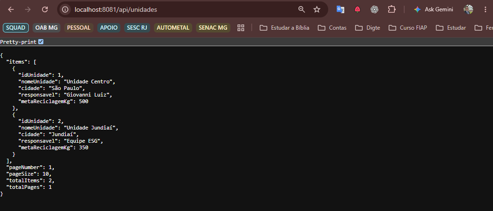

### E07 - Produção simulada: prontidão na porta 8082

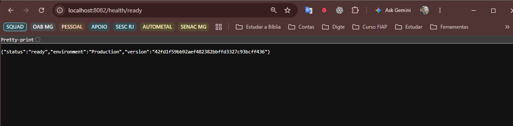

### E08 - Produção simulada: consulta de duas unidades

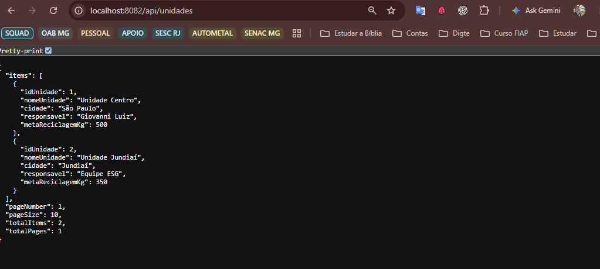

### E09 - Containers dos ambientes no Docker Desktop

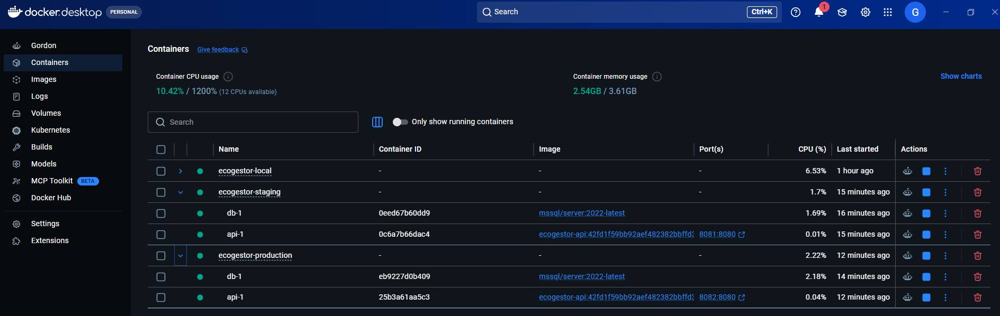

### E10 - Volumes separados para local, staging e produção

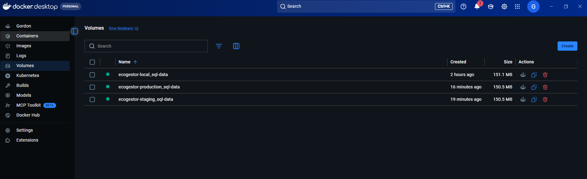

### E11 - Relatório protegido: resposta HTTP 200 no teste local

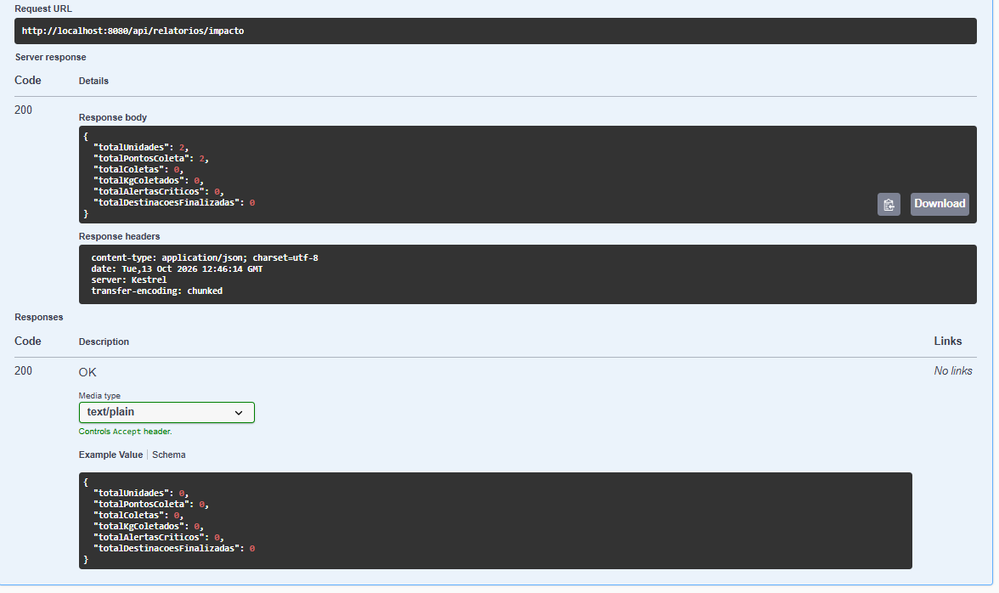

## Tecnologias utilizadas

C#, ASP.NET Core 8, Entity Framework Core 8, SQL Server 2022 Developer,
JWT, Swagger/OpenAPI, xUnit, Docker, Docker Compose, GitHub Actions e PowerShell.
O banco InMemory é usado apenas nos testes automatizados.

## Estrutura

```text
EcoGestorDevOps/
  Dockerfile
  docker-compose.yml
  .env.example
  EcoGestorApi.sln
  src/EcoGestorApi/
  tests/EcoGestorApi.Tests/
  .github/workflows/
  scripts/
  postman/
  docs/
  README.md
```

## Checklist obrigatório de entrega

Checklist conferido na finalização do pacote, com base nos arquivos e evidências incluídos.

- [x] Estrutura do projeto organizada para compactação.
- [x] ZIP final conferido após acrescentar as evidências.
- [x] Dockerfile funcional confirmado por execução.
- [x] Docker Compose escrito com volumes, variáveis e rede.
- [x] Docker Compose executado com sucesso.
- [x] Pipeline escrito com build, testes e deploy em dois ambientes.
- [x] Pipeline executado com sucesso no GitHub.
- [x] README com instruções.
- [x] README com prints ou links reais.
- [x] Documentação PDF final com evidências.
- [x] Deploy realizado e verificado em staging.
- [x] Deploy realizado e verificado em produção simulada.

## Fontes técnicas

- Material da Fase 6 fornecido pela FIAP e enunciado Desafio DevOps.
- https://docs.docker.com/compose/how-tos/startup-order/
- https://learn.microsoft.com/sql/linux/sql-server-linux-docker-container-deployment
- https://docs.github.com/en/actions/concepts/runners/self-hosted-runners
- https://docs.github.com/en/actions/reference/security/secure-use
